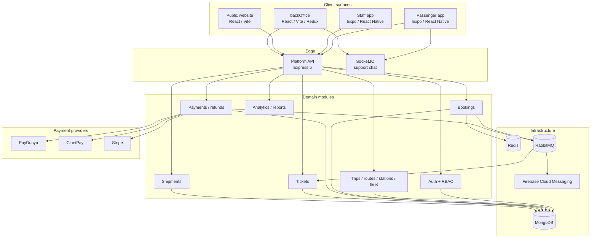
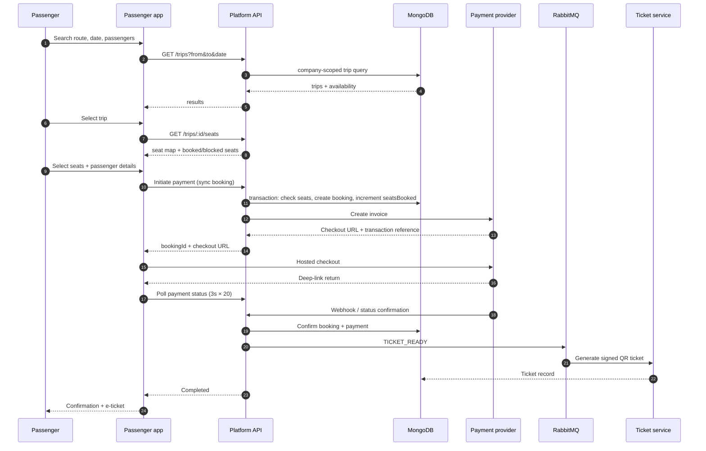
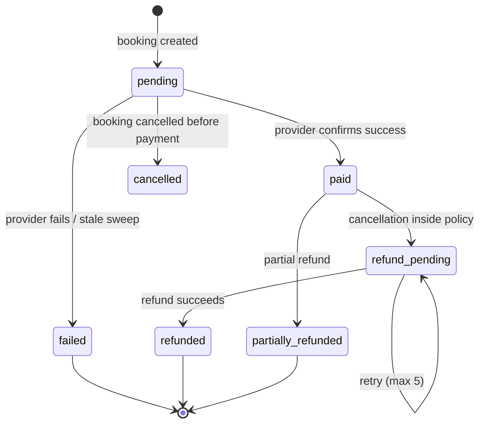

# JetExpress — Product Engineering Case Study

> **One line:** A multi-tenant transport operating system that keeps a seat, a payment, a ticket, and a parcel handoff consistent across a passenger app, a staff app, a public website, and an operator dashboard.

**Role:** Product Engineer (Contract) · **Period:** Jun 2026 — Present
**Scope:** 4 client surfaces + 1 platform API · **Market:** West African intercity bus operators
**Currency / Locales:** XOF · English / French
**Stack:** Expo SDK 57 / React Native 0.86, React 19 / Vite / Redux Toolkit, Node.js / Express 5, MongoDB / Mongoose, Redis, RabbitMQ, Socket.IO, PayDunya / CinetPay / Stripe, Firebase Cloud Messaging.

---

## TL;DR

A bus ticket looks simple from the outside: choose a seat, pay, show a QR code. Inside the operator, it is a chain of promises — inventory, money, identity, boarding, refunds, and a vehicle that must leave on time. JetExpress is the system that keeps those promises consistent across four client surfaces and many transport companies.

The case study focuses on five decisions:

1. **Build an operating system, not a booking page.**
2. **Keep passenger bookings and parcel shipments as separate domains.**
3. **Let the server own inventory and money; clients are entry points.**
4. **Make multi-tenancy a product contract, not a deployment trick.**
5. **Treat a ticket as a signed credential, not a screenshot.**

Each decision is written as **Problem → Decision → Trade-off → Engineering solution → Impact**, because that is the part of product engineering that is hardest to copy.

---

## 01. Product Overview

### What is it?

JetExpress is a multi-tenant transport operating system for intercity bus operators. It combines two businesses on one network:

- **Passenger ticketing** — search, seat selection, payment, e-ticket, boarding verification.
- **Parcel delivery** — sender/recipient capture, transport and last-mile pricing, custody handoffs, delivery or pickup.

Four client surfaces share one platform API:

| Surface | User | Job |
|---|---|---|
| **Jet Express passenger app** (Expo / React Native) | Travelers | Search, book, pay, retrieve ticket, manage bookings, support chat, notifications. |
| **Staff app** (Expo / React Native) | Drivers, cashiers, inspectors, station managers, trip managers | See assigned trips, passenger lists, scan tickets, manual verification, counter bookings. |
| **backOffice** (React / Vite / Redux Toolkit) | Operator admins and managers | Routes, stations, cities, buses and seat layouts, trips, bookings, payments, employees, maintenance, inventory, analytics, CMS. |
| **Public website** (React / Vite) | Prospective and existing customers | Discover routes, book, pay, manage a reservation, share a ticket. |
| **Platform API** (Node.js / Express 5) | All surfaces | Identity, tenancy, trips, bookings, payments, tickets, shipments, notifications, analytics. |

### Who uses it?

- **Passengers** — often on intermittent connectivity, paying with mobile money or a card, using English or French, and expecting a ticket they can show at the door.
- **Field staff** — drivers and station teams who need the right trip, the right passenger list, and a fast way to verify a boarding pass.
- **Operator admins / managers** — the people who define routes, fares, seat layouts, staff assignments, and the operating rules the rest of the system enforces.
- **Platform admins** — the team that onboards, approves, suspends, and bills transport companies.

### What market is it for?

West African intercity bus operators. That context shapes the product:

- **XOF** currency and **English / French** locales.
- **Phone-first identity** — OTP login, with a PIN option for faster re-entry; passwords are not the primary path.
- **Mobile money and card** through hosted checkout (PayDunya for the passenger app, CinetPay on the web/counter path, Stripe retained for legacy/refund flows).
- **Weak-network tolerance** — safe reads are cached; seat selection, payment, and ticket retrieval stay server-backed.
- **Multi-operator reality** — one codebase, many companies, each with its own routes, staff, branding, payment methods, and data.

### What is the business model?

B2B2C SaaS. A transport company registers, the platform approves it, and the operator runs its passenger and parcel business on the platform. Tenant settings carry the commercial rules:

- plan and subscription state,
- commission percentages (platform / driver),
- tax and pricing multipliers,
- feature flags for booking, payments, ticketing, and maintenance mode,
- timezone and currency.

The operator earns seat fares and parcel fees. The platform earns subscription/commission revenue and provides the operating system. The same codebase can be branded per operator through issued app identities, so onboarding a new company is configuration rather than a fork.

### My role and ownership

I worked as a **Product Engineer (contract)** across the passenger app, the staff app, the public website, and the platform API contracts. The operator dashboard was built in the same codebase and is the control plane I designed against.

My ownership concentrated on the decisions that keep the core promise honest:

- booking consistency under concurrency,
- payment settlement across redirects, webhooks, and polling,
- ticket trust at boarding,
- multi-tenant identity and data isolation,
- the flows that connect those pieces across surfaces.

I did **not** own the commercial launch metrics, and I do not claim them here. The results section separates what is verified in the implementation from what still needs instrumentation.

---

## 02. The Problem

### The passenger problem: “Is this seat actually mine?”

A passenger sees an available seat, selects it, enters details, and pays. In a naive system, three things can go wrong:

1. **The seat is taken between selection and payment.** The UI said “available,” but availability was a snapshot, not a reservation.
2. **The payment redirect succeeds while the app loses the response.** The passenger is charged, but the app cannot confirm the booking.
3. **The ticket is not trustworthy at boarding.** A screenshot or an edited QR payload can look like a valid ticket.

Add weak connectivity, app restarts, token expiry, and two languages, and the “simple” booking flow becomes a distributed-systems problem with a human waiting at the counter.

### The operator problem: the business runs on fragments

Before a system like this, an operator’s truth is spread across spreadsheets, WhatsApp messages, paper manifests, and cash drawers. The pain points are consistent:

- **Overbooking** — two agents sell the same seat; the passenger finds out at the door.
- **Revenue leakage** — counter sales, refunds, and commissions do not reconcile.
- **No single view** — trips, fleet, staff, bookings, parcels, and maintenance live in different places.
- **Weak field handoffs** — the station team cannot verify who should board, and the parcel team cannot prove who has custody.
- **Station-scoped reality** — a cashier at one station should not see or sell every trip in the company.

### The platform problem: many companies, one system

Each transport company is a tenant with its own:

- routes, stations, cities, and per-stop fares,
- buses and seat layouts,
- staff and role assignments,
- payment methods and commercial settings,
- customer and staff app branding.

A single-tenant app cannot be sold to many operators. A multi-tenant app that trusts a client-supplied `companyId` is a data leak waiting to happen. The platform must make tenancy a first-class contract, not a query parameter.

### Why existing solutions were not enough

- **Generic booking engines** model products and orders, not seat maps, boarding, per-stop fares, station-scoped cashiers, parcel custody, or refund tiers.
- **White-label handoffs** (the Greyhound → Booking.com pattern documented in the project’s web audit) give up the funnel, the customer relationship, and the data. They also make it impossible to model the operator’s real inventory and staff workflows.
- **Single-tenant apps** force a fork per company and make platform-level analytics, billing, and onboarding impossible.

### What had to be solved first

**Seat and payment integrity.** A ticket that is not real at boarding destroys trust faster than a missing feature. An overbooked seat is the most expensive failure because it turns a digital error into a physical confrontation.

The sequence was deliberate:

1. Make the core promise trustworthy: search → seat → pay → ticket.
2. Give the operator a control plane for inventory and staff.
3. Give the field a verification tool.
4. Add parcel delivery on the same network.
5. Add analytics, CMS, and platform operations.

That sequence is a product decision, not a technical one. It protects the loop that generates revenue before expanding the surface area.

---

## 03. Product Decisions

### Decision 1 — Build an operating system, not a booking page

**Problem:** A booking page can sell a seat. It cannot verify the ticket at the door, account for the parcel in the hold, or tell the operator which trips are understaffed.

**Decision:** Build four client surfaces on one platform API. The passenger app and website sell; the staff app executes; the backOffice configures and operates.

**Trade-off:** More surfaces, more contracts, more testing, more failure modes. We accepted that because the operator’s real problem is operational consistency, not a prettier search page.

**What it changed:** Shared API contracts, one tenant identity, one booking/payment/ticket domain, and one place where business rules live.

### Decision 2 — Keep passenger Booking and parcel Shipment as separate domains

**Problem:** Both move on the same bus, so the tempting shortcut is a generic “order” with a type field. That hides the states that matter.

**Decision:** Model them separately, linked to shared transport resources.

- A **Booking** is defined by seat, fare, passenger, payment, and boarding.
- A **Shipment** is defined by sender, recipient, item, custody, last-mile choice, and proof of handoff.

**Trade-off:** Two domains to maintain, and the shared resources (trips, stations, buses) must be linked carefully.

**Impact:** Parcel services can be added without destabilizing passenger inventory or ticketing. Each domain can evolve its own states and evidence.

### Decision 3 — The server owns inventory and money; clients are entry points

**Problem:** A client cannot be the source of truth for a seat or a payment. Redirects, retries, offline states, and app restarts make client state unreliable.

**Decision:** The API owns seat validation, payment settlement, refund policy, and ticket issuance. The client owns presentation and local, safe-to-cache reads.

**Trade-off:** The client sometimes waits, or learns about a conflict later. The UX must explain the wait and recover from the conflict without losing the passenger’s context.

**Impact:** No double-sell path. Payment confirmation is based on provider evidence and a server-calculated amount. Tickets are issued only after settlement.

### Decision 4 — Multi-tenancy by app identity, not by deployment

**Problem:** One API serves many companies. A client-supplied `companyId` is a tampering vector. App builds still need to know which tenant they belong to without hardcoding Mongo ObjectIds.

**Decision:** Issue two app identities per tenant at registration — a customer app ID (`cust_...`) and a staff app ID (`staff_...`). Mobile builds send the ID in an `x-app-id` header. The API resolves it to a tenant, checks that the tenant is active, and scopes every repository query by `companyId` from the authenticated context.

**Trade-off:** The app ID is an identifier, not a secret. Authentication is still required. The platform must protect the resolution path and enforce tenant status centrally.

**Impact:** Onboarding a new operator is configuration, not a fork. Cross-tenant reads and writes are blocked by construction, not by convention.

### Decision 5 — Sequence the features around the promise

**Built first:**

- passenger search, trip details, seat selection, passenger details, payment, ticket;
- operator setup for cities, stations, routes, buses, seat layouts, trips;
- staff trip lists and ticket scanning;
- manual/counter booking with correct ticket timing.

**Deliberately deferred or cut:**

- **Customer-facing parcel tracking** — parcel booking is operator-led in v1. The customer app does not expose it.
- **In-app card collection** — hosted checkout only. The platform does not store card details.
- **Anonymous seat viewing** — the seat map requires authentication initially. This is a conversion trade-off, documented as a future improvement.
- **Self-service cancellation and seat-change UI** — the backend services exist, but the customer UI was deferred.
- **Payment history UI** — the API exists, but the screen was deferred.
- **Thousands of SEO landing pages** — the web audit recommended skipping thin content for a small destination network.

**Why:** Protect the core loop first. Do not build secondary surfaces before the primary promise is trustworthy.

### Business requirement → technical requirement

| Business requirement | Technical translation |
|---|---|
| “Never sell the same seat twice.” | MongoDB transaction: validate seat existence, conflicts, and blocked seats; create the booking; increment `seatsBooked` on the trip. Retry transient conflicts. The trip document write is the serialization point. |
| “A redirect is not a payment.” | Server-side provider status and amount verification; idempotent fulfillment; stale-payment sweeper; auto-refund if a paid booking cannot be completed. |
| “A ticket must be real at boarding.” | Ticket issued only after settlement; HMAC-signed QR over a canonical payload; staff scanner verifies the signature and the booking state. |
| “Each company sees only its data.” | `companyId` from the authenticated tenant/app identity, never from the request body; repository-level scoping; role checks; tenant status enforced centrally. |
| “A cashier sees only their station’s trips.” | Station-scoped booking queries for cashier and station-manager roles. No assignment means no visibility. |
| “Refunds follow a published policy.” | Pure refund function: 100% at ≥48h, 75% at 24–48h, 50% at 2–24h, 0% under 2h. Departure instant resolved in the tenant’s timezone. |
| “Do not let a customer book a bus that leaves in 10 minutes.” | Self-service cutoff: bookings close 2 hours before departure, enforced in the service as defense in depth. |
| “Operators need one view of revenue.” | Payment records net of refunds; analytics for revenue, bookings, trips, users, route performance, bus utilization, cancellations, and peak times. |
| “A walk-in passenger should still get a real ticket.” | Manual booking find-or-creates the passenger by phone/email, runs the same booking pipeline, and issues the ticket only when money is actually collected. |

---

## 04. System Design & Architecture

### High-level architecture



### Backend layering

Every backend module follows one vertical slice:

```
Routes → Controller → Service → Repository → Model → MongoDB
```

The rules are explicit:

- **Routes** mount authentication, role checks, and Joi validation. They contain no logic.
- **Controllers** read `req`/`res`, call one service method, shape the response, and pass errors to the central error middleware. They never import repositories or models.
- **Services** own business rules: state machines, ownership checks, transactions, retries, cross-module calls, queue publishing.
- **Repositories** own data access, always scoped by `companyId`.
- **Models** own schema and invariants (indexes, booking-code generation).

This matters for a multi-tenant platform because it gives each rule exactly one home. Seat-conflict rules live in `booking.validation.service.js`; the refund policy lives in `cancellation.service.js`; queue publishing lives in `booking.publish.service.js`. A controller cannot accidentally bypass a tenant check because it cannot reach the model.

### Data model (core collections)

| Collection | Responsibility | Key relationships |
|---|---|---|
| `Tenant` | A transport company: status, plan, settings, customer/staff app IDs. | Root of every company-scoped query. |
| `User` | Passengers, staff, admins, platform admins. | Belongs to a tenant; role determines access. |
| `City` / `Station` | The operating network. | Stations belong to cities; routes connect stations. |
| `Route` | Ordered stops and distances. | Stops reference stations; trips snapshot the route. |
| `Bus` | Vehicle, capacity, seat layout. | Assigned to trips; seat labels drive the passenger seat map. |
| `Trip` | A dated departure: route, bus, times, price, per-stop fares, blocked seats, `seatsTotal`, `seatsBooked`, staff assignments. | The serialization point for seat inventory. |
| `Booking` | A passenger purchase: seats, passengers, total, status, payment status, drop-off station, boarding status. | Belongs to a trip and a user; issues tickets. |
| `Payment` | Provider, transaction reference, amount, status, refunded amount, pending refund intent. | One per booking attempt; drives refunds and revenue. |
| `Ticket` | A signed QR credential per passenger/seat. | Belongs to a booking; verified by staff. |
| `Shipment` | Parcel custody: sender, recipient, item, pricing, payer, delivery mode, status history. | Linked to trips/vehicles and stations. |
| `Plan` / `PlanChangeRequest` | Subscription catalog and tenant change requests. | Platform-level commercial state. |
| `Audit` | Who did what, when, in which module. | Cross-cutting evidence for operators. |
| `Notification` / `Device` | Localized notifications and FCM tokens. | Per user and tenant. |

### API and service communication

- **REST `/api/v1`** is the contract for all four clients. Responses use one envelope: `{ success, message, data, pagination }`.
- **Provider webhooks** are mounted before `express.json()` because they own their body parsing. PayDunya sends form-encoded callbacks; CinetPay authenticates its callback with a per-payment notify token.
- **RabbitMQ** carries asynchronous work: `booking.queue`, `ticket.queue`, `notification.queue`, `refund.queue`, and a ticket dead-letter queue. Consumers are triggers only — they parse, check idempotency, call the same service the synchronous path uses, then ack/nack.
- **Socket.IO** carries support chat. Chat persistence still goes through the chat module’s service/repository stack.
- **Redis** carries short-lived seat holds (600-second TTL) and is also used as a fast coordination layer. It is not the authoritative seat ledger.
- **`Cache-Control: no-store`** is set on authenticated API payloads. Express emits ETags by default; without this, React Native’s HTTP client could revalidate a search with `If-None-Match` and receive a `304` with an empty body, which the app would read as “no results.”

### State management by surface

| Surface | State approach | Why |
|---|---|---|
| Passenger app | Shared booking context + hooks; SecureStore for tokens and language; TTL cache for profile, bookings, booking details. | The booking wizard spans multiple screens; safe reads must survive weak networks; seat/payment state must not be cached. |
| Staff app | Auth/session state + API services; SecureStore; focused screens for trips, scanning, and bookings. | Field work needs fast, obvious state, not a global store. |
| backOffice | Redux Toolkit slices: auth, dashboard, bookings, trips, fleet, users, routes, tickets, config, stations. | Many resource-heavy screens with pagination, filters, and optimistic updates. |
| Public website | Local state + API calls; server-backed trip/seat/payment flow. | The site mirrors the passenger flow without maintaining a second inventory model. |

### Scalability considerations

What the design does well:

- Stateless API instances behind a load balancer.
- Company/date/status indexes on trips; company-scoped indexes on bookings and payments.
- Queue consumers isolate ticket generation, notifications, and refund retries from the request path.
- Idempotency keys on payment events prevent duplicate fulfillment.
- A payment-expiry sweeper reclaims abandoned inventory.
- Retry budgets and dead-letter queues make failures visible.

What still needs work (and is listed in section 08):

- The in-memory seat-hold fallback is single-instance only. It degrades rather than fails when Redis is unavailable, but it cannot be the production correctness story at scale.
- Socket.IO needs a Redis adapter and sticky sessions before horizontal scaling.
- Queue publishing happens after the Mongo commit. A transactional outbox would close the crash window between commit and publish.
- There is no verified load test in the source material. Concurrency behavior is reasoned and tested at the transaction level, not proven at production volume.

### Technology choices and why

| Choice | Why it fits this product |
|---|---|
| **Expo / React Native** | One codebase for two mobile apps (passenger and staff), OTA updates, native access for camera, notifications, secure storage, and PDF sharing. |
| **React / Vite** for web surfaces | Fast iteration for the public site and the operator console; shared TypeScript/React skills across surfaces. |
| **Redux Toolkit** in backOffice | Predictable state for many resource screens, pagination, filters, and role-filtered navigation. |
| **Node.js / Express 5** | The domain is I/O-heavy and CRUD-heavy; the team can share one language across API and clients. |
| **MongoDB / Mongoose** | Flexible documents fit per-operator seat layouts, per-stop fares, and nested passenger records; multi-document transactions cover the booking commit. |
| **Redis** | Native TTL is a good fit for short-lived seat holds and fast reads. |
| **RabbitMQ** | Ticket generation, notifications, and refund retries should not block a passenger request; queues also give retries and a DLQ. |
| **Socket.IO** | Support chat needs bidirectional, authenticated messaging without building a protocol from scratch. |
| **PayDunya / CinetPay / Stripe** | West African mobile-money and card coverage; hosted checkout keeps card data out of the app; provider adapters keep settlement logic provider-agnostic. |
| **JWT + refresh tokens + SecureStore** | Stateless API auth with short-lived access tokens and secure device storage. |
| **Joi + central error middleware** | One input contract and one error vocabulary across modules. |

---

## 05. Key Product Flows

### Flow A — Passenger booking



| Step | Passenger sees | System does | Failure handling |
|---|---|---|---|
| **Search** | From/to city type-ahead, date in a 14-day window, 1–10 passengers. | Matches local city data, queries company-scoped trips for the route/date, returns availability. | Missing city blocks the search with a clear alert; empty results show a “no trips” state. |
| **Trip details** | Bus, route, stations, times, duration, type, capacity, price. | Resolves trip and bus data; carries passenger count forward. | Meaningful placeholder instead of a crash when data is unavailable. |
| **Seat selection** | Seat map from the bus layout; available / selected / booked legend; max seats = passenger count. | Fetches the layout; marks booked and blocked seats; validates the selection limit. | Changing the bus clears the selection and refetches the map. |
| **Passenger details** | One name + phone per seat; running total. | Validates every passenger; stores details in booking state. | Submission is blocked with the first missing passenger named. |
| **Payment summary** | Route, date, seats, passengers, total in XOF. | Read-only summary; “Proceed to Payment.” | The summary currently shows the first passenger only — a known gap. |
| **Payment** | Exact total on the CTA, e.g. `Pay 12,500 XOF`. | Creates the booking with immediate server sync and a provider invoice; returns a checkout URL. | A seat conflict (HTTP 409) clears the booking state, shows “Seats Unavailable,” and offers a return home. |
| **Checkout** | Hosted provider page for mobile money or card. | Opens an auth session; uses the app deep link as the return target. | Cancelling or dismissing routes to failure; the booking stays held until server expiry reclaims it. |
| **Return / poll** | “Do not close the app” confirmation state. | Polls every 3 seconds for up to 20 attempts (~60 seconds); ignores transient network errors. | `completed` → success; `failed`, missing token, or exhausted attempts → failure. Polling settles exactly once. |
| **Confirmation** | Booking confirmed; e-ticket available. | Clears booking state; ticket is generated asynchronously after settlement. | “Retry Payment” restores the in-flight booking state — a path that still needs hardening (see section 08). |

**Product rules enforced in this flow:**

- Self-service bookings close **2 hours before departure**.
- API requests time out after **20 seconds** with a readable error.
- Seat selection, payment, and ticket data are **not cached**; profile, bookings, and booking details are.
- The seat conflict is surfaced at payment time rather than prevented at selection — an explicit trade-off explained in section 06.

### Flow B — Operator manual / counter booking

| Step | Operator sees | System does | Why it matters |
|---|---|---|---|
| **Open counter booking** | Trip search scoped to the staff member’s role and station. | Cashiers and station managers see only trips at their assigned stations. No assignment means no visibility. | Prevents a station agent from selling inventory they do not operate. |
| **Identify passenger** | Name, phone, optional email. | Finds an existing passenger by email or phone/company; creates a walk-in account only if needed. | A passenger who books twice at the counter should not end up with two accounts and lose their first ticket. |
| **Select seats** | Same seat map and validation as the customer flow. | Runs the same synchronous booking pipeline. | Counter sales and online sales cannot diverge in seat rules. |
| **Take payment** | Cash or gateway. | **Cash:** booking completed and paid immediately; ticket issued. **Gateway:** booking pending and unpaid; ticket issued only after the webhook settles it. | A ticket is a boarding pass. Handing one over before money is collected would let someone board on an unpaid seat. |
| **Record the seller** | Staff identity. | Writes `createdBy` / `collectedBy` for the audit trail. | Cash reconciliation and dispute resolution need a named seller. |

### Flow C — Boarding verification

| Step | Staff sees | System does | Failure handling |
|---|---|---|---|
| **Assigned trips** | Trips the staff member manages, filtered by date/status. | Resolves trip assignments and passenger lists. | Empty states explain that no trips are assigned. |
| **Scan ticket** | Camera scanner. | Reads the signed QR payload, recomputes the HMAC, checks the booking/trip state, and records boarding. | Invalid signature, wrong trip, cancelled booking, or already-boarded state is rejected with a clear reason. |
| **Manual verification** | Search by booking code or passenger. | Falls back to the booking record when the camera or QR fails. | Keeps the queue moving at the station without trusting a screenshot. |
| **Record outcome** | Boarded / no-show / pending. | Only the trip’s manager can record boarding for that trip. | Unauthorized staff cannot mark a passenger boarded. |

### Flow D — Parcel shipment

| Step | Operator sees | System does | Why it matters |
|---|---|---|---|
| **Capture parcel** | Sender, recipient, item quantity/dimensions, declared value. | Creates a shipment record tied to the tenant. | A parcel is a different domain from a passenger booking. |
| **Price** | Transport charge, optional last-mile charge, payer, cash state. | Calculates totals from trusted server data; records who pays. | The operator can reconcile parcel revenue separately from seat revenue. |
| **Choose delivery** | Station pickup or address delivery. | Stores the chosen mode and the required handoff evidence. | The promise differs: pickup needs a station handoff; delivery needs a last-mile handoff. |
| **Assign transport** | Bus/truck and trip. | Links the shipment to shared transport resources. | Parcels ride the same network without becoming passenger bookings. |
| **Move custody** | Received → assigned → in transit → arrived → ready → delivered. | Updates the shipment state and timestamps. | Each state implies a next owner and action, which is more useful than a generic “processing” label. |
| **Handle exceptions** | Exception / returned. | Keeps unresolved delivery work visible. | A delayed or refused parcel should not disappear from the operator’s queue. |

**Current scope:** parcel booking and tracking are operator-led in v1. The customer app does not expose parcel tracking.

### Flow E — Payment failure, expiry, and refund



- **Abandoned checkout:** the provider can leave an invoice pending far longer than the operator can hold inventory. A sweeper re-confirms stale payments after **15 minutes**, every **5 minutes**, and fails the ones that never completed — which cancels the booking and releases the seats.
- **Cancellation:** the booking is cancelled, the refund policy is applied (100% ≥48h, 75% 24–48h, 50% 2–24h, 0% <2h), and the payment is marked `refund_pending`.
- **Refund retry:** a failed provider refund is persisted as a pending refund intent and retried by the refund queue, up to **5 attempts**. A boot-time recovery sweep re-enqueues intents that were persisted but never attempted, covering the crash window between cancellation and the provider call.
- **Paid but unfulfillable:** if money arrives but the booking cannot be completed, the platform auto-refunds instead of stranding the customer’s cash against a booking that will never exist.
- **Duplicate notifications:** payment events are keyed per booking/outcome. Without keys, a consumer retry republished the same event and one user received **23 identical “payment failed” notifications**. The key makes the notification idempotent without blocking a later success.

---

## 06. Engineering Challenges & Trade-offs

### Challenge 1 — Double-booking under concurrency

**Problem:** Two passengers select the same last seat. Payment redirects widen the window between selection and confirmation. Retries can create a self-inflicted conflict: the same user’s first attempt holds the seat, the retry sees the hold, and the system reports “seats already held by another user” to the user who holds them.

**Options considered:**

| Option | Why it was rejected |
|---|---|
| **Client-side seat lock** | Untrustworthy. A client can be edited, replayed, or disconnected. |
| **Redis hold as the sole source of truth** | TTL expiry can release a seat mid-payment; Redis unavailability weakens correctness; the hold is not the committed inventory. |
| **MongoDB transaction with seat conflict check + trip capacity increment + retry** | Chosen. The trip document write serializes concurrent bookings for the same trip. |

**Decision:** The authoritative check happens inside the booking transaction:

1. Validate seat existence, duplicates, blocked seats, and conflicts.
2. Create the booking.
3. Increment `seatsBooked` on the trip document.
4. Commit.
5. Retry transient transaction conflicts up to 5 times with backoff.

The trip write is the serialization point. Two concurrent bookings collide on that write, one retries, and the retry sees the other booking’s committed seats.

**Trade-off:** A genuine conflict can surface at booking/payment time rather than at seat selection. The app must handle a 409 gracefully, clear the stale selection, and let the passenger choose again. Redis holds remain useful for UX and expiry, but they are not the correctness boundary. The hold was removed from the booking-creation path because it caused the self-conflicted 409 described above.

**Engineering solution details:**

- `checkSeatConflicts` runs inside the session.
- `incrementSeats` on the trip is part of the same transaction.
- Booking-code unique-index collisions are retried like transient errors; an exhausted budget returns a 409.
- Seat changes use the same serialization trick: a zero-delta trip write forces concurrent changes to conflict and retry.
- Blocked seats and seat-range validation are checked again inside the transaction, not only at the edge.

**Impact:** There is no path that commits a booking without the seat check. Capacity stays consistent with booking records. Conflicts become explicit, recoverable states instead of silent double-sells.

### Challenge 2 — Payment settlement across redirects, webhooks, and polling

**Problem:** Hosted checkout returns the passenger before the provider settles. The app can close, lose connectivity, or return early. Webhooks can arrive late or twice. A booking can be paid but unfulfillable. An abandoned checkout can hold a seat indefinitely.

**Options considered:**

| Option | Why it was rejected |
|---|---|
| **Trust the return URL** | A redirect is a browser event, not money. |
| **Poll only** | Insufficient alone; the webhook can settle first, and polling stops when the app closes. |
| **Server-owned settlement state machine + webhook + polling + expiry sweeper** | Chosen. |

**Decision:** A provider-agnostic fulfillment service owns settlement:

- Confirm the booking idempotently.
- Verify provider status and amount against the server-calculated fare.
- Publish post-payment events (ticket, notifications) only after settlement.
- Persist a pending refund if the booking cannot be completed.
- Sweep stale invoices and fail abandoned checkouts.

**Trade-off:** Seats stay unavailable longer when settlement is uncertain (15 minutes by default) than the app’s 60-second polling window. That is intentional: keeping a seat unavailable a little longer is better than falsely failing a payment and selling the seat twice.

**Engineering solution details:**

- Idempotent booking confirmation; duplicate webhooks do not double-fulfill.
- Payment status is rechecked by the expiry sweeper, not just trusted from the callback.
- The refund queue has a retry budget and a boot-time recovery sweep.
- Notification events are keyed per booking/outcome to prevent duplicates.
- The webhook routes are mounted before the JSON parser because they own their body parsing.

**Impact:** A redirect is never treated as payment. Duplicate callbacks are harmless. Abandoned checkouts release inventory. Refunds do not silently disappear when the provider fails.

### Challenge 3 — Ticket trust at boarding

**Problem:** The QR payload was plain, unsigned JSON. Because verification looked the payload up in the database, anyone who could edit the string could hand the scanner `{"bookingId":"<id>"}` or `{"ticketId":"<id>"}` and board a passenger.

**Options considered:**

| Option | Why it was rejected |
|---|---|
| **Database lookup only** | Forgeable. The payload itself is not evidence. |
| **Random opaque token** | Better, but it needs a lookup and does not bind the route, seat, and trip into the credential. |
| **HMAC-signed canonical payload** | Chosen. |

**Decision:** Sign a stable canonical array of identity and routing fields with HMAC-SHA256. The scanner recomputes the signature and compares it in constant time. Tickets are issued only after payment settlement.

**Trade-off:** The signing key becomes operationally critical. Rotating it invalidates old tickets unless the payload carries a key ID/version. That is a future improvement, not a reason to ship unsigned tickets.

**Engineering solution details:**

- The signature covers ticket number, ticket/booking IDs, company, user, seat, trip, date, times, stations, and bus number.
- The signature field itself is excluded to avoid circularity.
- Operational values (actual times, delay minutes) are excluded so a ticket issued before departure does not carry a stale snapshot.
- `timingSafeEqual` prevents timing leaks; length mismatch is guarded first.
- If the key is not configured, ticket generation does not silently proceed unsigned where it matters.

**Impact:** A screenshot cannot be edited into another passenger’s boarding pass. Staff can verify the credential against the signature and the booking state, not just against a database row.

### Challenge 4 — Multi-tenant identity and isolation

**Problem:** One API serves many companies. A client-supplied `companyId` is a data-leak vector. Mobile builds need to know their tenant without hardcoding database IDs. A suspended tenant must not keep operating.

**Options considered:**

| Option | Why it was rejected |
|---|---|
| **Subdomain per tenant** | Heavier operations; mobile builds still need configuration; it does not solve the API scoping problem by itself. |
| **`companyId` in request body/query** | Tampering vector. Rejected. |
| **Issued app IDs + `x-app-id` header + auth-derived `companyId`** | Chosen. |

**Decision:** Issue `cust_...` and `staff_...` IDs at tenant registration. Resolve the header once, attach the tenant to the request, reject unknown or inactive tenants, and scope every repository query by the authenticated company. Never trust a client-supplied `companyId`.

**Trade-off:** The app ID is an identifier, not a secret; authentication is still required. Per-tenant rate limits and quotas are a future hardening step.

**Engineering solution details:**

- `customerAppId` and `staffAppId` are unique and issued at registration; older tenants are backfilled.
- Tenant status (`pending`, `active`, `suspended`) is enforced centrally in authentication.
- `platform_admin` is deliberately excluded from assignable roles, so a tenant admin cannot mint a global superuser through the user-creation endpoint.
- Services strip `companyId` from update payloads to prevent cross-tenant writes.
- Staff visibility is further narrowed by role: cashiers and station managers only see bookings for trips at their assigned stations.

**Impact:** Onboarding is configuration, not a fork. Cross-tenant reads and writes are blocked by construction. The platform can hold customer identity, bookings, payments, and parcels for different operators without mixing them.

### Challenge 5 — Weak-network passenger experience

**Problem:** Intermittent connectivity, app restarts, expired tokens, stale data, and a subtle HTTP bug: Express ETags plus React Native’s HTTP client could revalidate a search with `If-None-Match`, receive a `304` with an empty body, and render “no results.”

**Options considered:**

| Option | Why it was rejected |
|---|---|
| **Online-only** | Poor experience for the exact users the product serves. |
| **Cache everything** | Dangerous for seats and payments. Stale data can create a false promise. |
| **TTL cache for safe reads + server-owned critical paths** | Chosen. |

**Decision:** Cache profile, bookings list, and booking details with a TTL, namespaced per user, cached-first then fresh. Keep tokens and language in SecureStore. Validate the access token’s `exp` locally, refresh on expiry, and retry a 401 once. Do not cache search, seat maps, payment, or ticket data. Set `Cache-Control: no-store` on authenticated API payloads.

**Trade-off:** Cached booking details can be stale. The offline banner makes that explicit. Critical actions require connectivity.

**Impact:** The app remains useful for reviewing a trip or ticket offline without risking a false seat or payment promise.

### Smaller challenges worth naming

- **Notification duplication:** keyless payment events were republished on consumer retries; one user received 23 identical “payment failed” rows. Fixed with per-booking/per-outcome keys.
- **Queue publish after commit:** if the process dies between the Mongo commit and the RabbitMQ publish, the event can be lost. A transactional outbox is the correct next step.
- **Webhook body parsing:** PayDunya’s form-encoded callback and CinetPay’s token-authenticated callback must be mounted before `express.json()`, or the body is consumed by the wrong parser.
- **Timezone-aware refunds:** the departure instant is resolved in the tenant’s timezone, not the server’s, so a 48-hour refund tier does not shift with the host.
- **Date-only filters:** `dateFrom`/`dateTo` are closed in UTC to avoid truncating the day for servers east or west of UTC.
- **Seat availability UX:** the app derives availability from the bus layout rather than per-trip holds, so a genuine conflict surfaces at payment. This is a known gap, not a hidden one.

---

## 07. Results & Business Impact

### What shipped

| Surface | Delivered capability |
|---|---|
| **Passenger app** | Phone OTP/PIN auth, session restore, search, results, trip details, seat selection, passenger details, payment summary, PayDunya checkout, polling, confirmation, bookings list/details, e-ticket PDF/share, QR ticket, notifications with deep links, support chat, offline cache, English/French, profile, legal pages. |
| **Staff app** | Login/PIN, assigned trips, passenger lists, ticket scanning, manual verification, counter bookings, fleet view, payment, reports, notifications. |
| **backOffice** | Executive dashboard and analytics, online/manual bookings, one-off and recurring trips, routes/stations/cities, fleet/maintenance/inventory, users/employees, tickets, config, subscription/plans, support chat, tenants/platform dashboard, CMS/site content. |
| **Public website** | Home/search, results, seat selection, passenger/payment flow, payment return, manage booking, account/bookings, share ticket, content pages, login. |
| **Platform API** | Multi-tenant auth/RBAC, trips and per-stop fares, bookings, payments/refunds, tickets, shipments, fleet/maintenance, analytics/reports, notifications, chat, audit, CMS, plans, uploads, devices. |

### Verified engineering outcomes

These are facts from the implementation, not marketing claims:

- **4 client surfaces + 1 platform API**, across **5 repositories** and **24 backend modules**.
- **14 assignable roles** plus `platform_admin`; **3 tenant states** (`pending`, `active`, `suspended`).
- **4 refund tiers**; **2-hour** self-service booking cutoff; **600-second** seat-hold TTL.
- **15-minute** payment expiry window, swept every **5 minutes**; **5** refund retries; **20-second** API timeout.
- **3-second** payment polling for up to **20 attempts** (~60 seconds).
- **HMAC-SHA256** ticket signing with timing-safe verification.
- **Idempotent** payment event processing and keyed notifications.
- **English/French** localization and **XOF** currency; roughly **300 West African cities** in the passenger app’s local search data.

### Business impact

What the system enables:

- **Online sales without double-selling** — the committed booking owns the seat.
- **Counter sales with an audit trail** — the seller is recorded, cash and gateway settlements are distinct, and the ticket follows the money.
- **Boarding verification** — staff can trust a signed credential instead of a screenshot.
- **Parcel revenue on the same network** — parcel work rides existing trips and stations without contaminating passenger inventory.
- **Operator visibility** — revenue, bookings, utilization, cancellations, peak times, and route performance in one console.
- **Multi-tenant onboarding** — a new company is configuration, not a fork.

What I am **not** claiming:

- Verified passenger counts, revenue, conversion lift, or cost savings. Those numbers are not in the source material.
- A production load-test result. The concurrency design is reasoned and transaction-tested, but not proven at a specific request volume.
- Customer adoption or retention. The product surfaces exist; the commercial metrics need instrumentation.

### Metrics I would instrument next

| Question | Metric |
|---|---|
| Where do passengers drop off? | Search → seat selected → passenger details → payment → ticket funnel. |
| Is payment reliable? | Success rate by provider, pending age, abandoned-checkout rate. |
| How often do seat conflicts happen? | 409 rate per trip, per route, per time window. |
| Are refunds healthy? | Refund age, retry count, exhausted retry budget, pending-refund backlog. |
| Does boarding work? | Scan success rate, manual-verification rate, rejected-ticket reasons. |
| Is the network utilized? | Seat utilization, route performance, cancellation rate, peak departure times. |
| Is the operator succeeding? | Time from onboarding → first trip → first booking; active staff per tenant. |
| Is parcel delivery healthy? | Dwell time per custody state, exception rate, return rate. |
| Is support effective? | First response time, resolution time, chat-to-booking conversion. |

### Current state

The system is actively developed. The passenger app is at **v1.0.8 (versionCode 26)** and the staff app at **v1.0.4 (versionCode 14)**. The backend has integration tests against an in-memory MongoDB replica set, Swagger docs for the API and mobile contracts, and deployment artifacts for a hosted environment. The codebase is built for production (release signing, ProGuard/shrinking, EAS builds, Firebase configuration), but “built for production” is not the same as “verified at scale” — which is why the next section exists.

---

## 08. What I Would Improve

### If I rebuilt it

1. **Add a transactional outbox for domain events.** Booking confirmation, ticket generation, notifications, and refunds currently publish after the Mongo commit. If the process dies in that window, the event is lost. An outbox table written inside the transaction, with a relay to RabbitMQ, makes the saga durable.
2. **Add client idempotency keys to booking creation.** The consumer is idempotent by `eventId`, but a client retry can still create a second booking request. A client-generated request ID stored on the booking closes that gap.
3. **Replace the advisory seat hold with an explicit reservation state machine.** States: `held → pending_payment → confirmed → cancelled/expired`. Make the hold idempotent per user/booking attempt with a Redis Lua script or a database row, so a retry cannot conflict with the user’s own hold. Keep the Mongo transaction as the final correctness boundary.
4. **Expose per-trip seat availability to the client.** The passenger app currently derives availability from the bus layout. A dedicated availability/hold endpoint would let the UI show real holds and prevent most conflicts at selection instead of at payment.
5. **Finish the self-service lifecycle.** The backend has cancellation and seat-change services; the customer UI does not expose them. The “Retry Payment” path also needs to preserve booking state after a 409 or poll failure instead of navigating to an empty payment screen.
6. **Make observability first-class.** Structured logs with request, tenant, booking, and payment IDs; metrics for payment success, 409s, queue lag, refund age, and DLQ depth; tracing across API → queue → consumer; alerts for pending refunds and exhausted retries.
7. **Load-test the booking path.** Define SLOs for concurrent booking, payment initiation, and ticket retrieval. Test the trip-document serialization point under realistic contention.
8. **Harden horizontal scaling.** Redis adapter and sticky sessions for Socket.IO; remove the in-memory seat-hold fallback from production (or make it an explicit single-instance dev mode); verify queue consumer scaling and idempotency under duplicate delivery.
9. **Add QR key rotation.** Put a key ID/version in the signed payload so keys can rotate without invalidating every outstanding ticket. Keep a verification audit log.
10. **Strengthen tenant isolation with automated tests.** Cross-tenant read/write attempts should be a test suite, not a code-review assumption. Add per-tenant rate limits and quotas.
11. **Improve the offline cache.** Add size limits, eviction policy, and a visible “last updated” timestamp. Cached booking details should never look fresher than they are.
12. **Close the small correctness gaps.** Payment summary should show every passenger, not only the first. Remove mock fallbacks from production paths. Replace the unused `GET /cities` dependency with a real remote city source or document the static list as a deliberate constraint. Add the missing `expo-file-system` dependency and remove debug logging.

### Architectural decisions I would revisit

| Decision | Why revisit | Likely direction |
|---|---|---|
| Redis hold as UX hint, DB transaction as truth | The split is sound, but the self-conflict story shows the hold needs idempotency per attempt. | Reservation state machine + idempotent hold + DB final check. |
| Publish-after-commit events | Crash window between commit and publish. | Transactional outbox + relay. |
| In-memory seat-hold fallback | Correct only on a single instance. | Redis-only in production; fail closed or degrade to a DB check. |
| Socket.IO without an adapter | Horizontal scaling needs shared state. | Redis adapter + sticky sessions. |
| Static city list in the passenger app | Convenient offline, but can drift from the operator’s network. | Bundled seed + remote refresh + versioned cache. |
| Provider-specific refund paths | PayDunya refunds by transfer, Stripe by charge reversal. | Keep the adapter boundary, but unify the refund state machine and evidence model. |

### Next product priorities

1. **Payment success rate** — provider routing/fallback, clearer retry UX, pending-age visibility.
2. **Seat conflict rate** — real availability at selection, not at payment.
3. **Operator activation** — time from onboarding to first published trip and first booking.
4. **Parcel turnaround** — dwell time per custody state and exception resolution.
5. **Support effectiveness** — response time and whether chat prevents a failed booking.
6. **Analytics trust** — reconcile dashboard revenue against provider settlements and refunds.

### What I would keep

- **Server-owned money and inventory.** The client should never be the source of truth for a seat or a payment.
- **Domain separation of Booking and Shipment.** Shared network, distinct promises.
- **Multi-tenant app identity.** One codebase, many operators, no forks.
- **The layered backend.** Routes → controller → service → repository → model gives every rule one home.
- **Honest failure states.** A conflict, a pending payment, and an expired checkout should be visible and recoverable, not hidden behind a spinner.

---

## Visual plan

The case study should use visuals to prove decisions, not decorate the page. Each visual below has a job.

| Visual | What it must prove | Where it goes |
|---|---|---|
| **System architecture** (Mermaid or the portfolio’s 3D system map) | Four client surfaces share one API; providers and infrastructure sit behind a domain boundary. | Section 04 |
| **Booking sequence** | A booking is a chain: seat check → transaction → payment → settlement → ticket. | Section 05, Flow A |
| **Payment state machine** | A redirect is not a payment; pending, paid, failed, refunded, and partially refunded are distinct states. | Section 05, Flow E |
| **Multi-tenant identity** | The app ID resolves the tenant; the token supplies the company scope; the client never supplies `companyId`. | Section 06, Challenge 4 |
| **Seat-conflict decision** | The trip document write is the serialization point; the retry sees the committed seat. | Section 06, Challenge 1 |
| **Ticket signing** | The QR payload is canonical and signed; the scanner verifies before trusting. | Section 06, Challenge 3 |

### Screenshot checklist

Capture only screens that explain a decision:

- **Passenger app:** search, results, seat map, passenger details, payment summary, checkout (redacted), confirmation, ticket/QR, bookings list, support chat, offline banner.
- **Staff app:** assigned trips, passenger list, scan success, scan failure, manual verification.
- **backOffice:** dashboard, trip create (recurrence and per-stop fares), booking detail, refund/cancel, fleet/seat layout, analytics, tenant/platform dashboard.
- **Public website:** home/search, results, seat selection, payment return, manage booking, share ticket.

For each screenshot, write a one-line caption that names the decision it demonstrates. If a screen does not prove a decision, it is decoration and should be cut.

---

## Evidence map

The claims in this case study are grounded in the source material:

| Claim | Source |
|---|---|
| Layered backend, module map, queue topology, testing strategy | `backend/ARCHITECTURE.md` |
| Seat holds: 600-second TTL, in-memory fallback, idempotent re-hold | `backend/src/services/seatHold.service.js` |
| Booking transaction, retries, self-conflict note, 2-hour cutoff, manual booking, refund tiers | `backend/src/modules/bookings/services/booking.service.js` |
| Idempotent payment settlement, auto-refund, refund retries, boot recovery | `backend/src/modules/payments/services/payment.service.js`, `paymentFulfillment.service.js` |
| 15-minute stale payment window, 5-minute sweep | `backend/src/modules/payments/services/paymentExpiry.service.js` |
| HMAC ticket signing, canonical payload, timing-safe verification | `backend/src/modules/tickets/services/ticketSigner.service.js` |
| `x-app-id` tenant resolution and status enforcement | `backend/src/middlewares/appIdentity.middleware.js` |
| Tenant app IDs, status, settings, plans, platform stats | `backend/src/modules/tenants/models/Tenant.js`, `services/tenant.service.js` |
| `platform_admin` excluded from assignable roles | `backend/src/constants/roles.js` |
| Passenger app requirements, payment polling, offline behavior, known gaps | `jetBusExpress/FUNCTIONAL_REQUIREMENTS.md` |
| backOffice stack, Redux slices, RBAC, API catalogue | `backOffice/LLD.md` |
| Public website flow, CinetPay path, Greyhound audit | `Transportation-website/docs/GREYHOUND-AUDIT.md` |
| Shipment, CMS, analytics, maintenance, plans modules | `backend/src/modules/*` |
| App versions and release configuration | `jetBusExpress/app.json`, `stuff_app/app.json` |

### Verification note

Business metrics such as passenger volume, revenue, conversion lift, and cost savings were **not** available in the source material, so they are not claimed. The case study distinguishes verified implementation facts from metrics that still need instrumentation. That distinction is intentional: a credible product case study should show how the system works and what it makes possible, not invent a number to fill a slide.

---

## One-paragraph version (for an interview or a portfolio intro)

JetExpress is a multi-tenant transport operating system for West African intercity bus operators. I worked across the passenger app, staff app, public website, and platform API on the decisions that keep a ticket real: transactional seat inventory, server-owned payment settlement, signed QR tickets, and tenant-scoped identity. The system supports online and counter sales, boarding verification, parcel delivery on the same network, and operator analytics. The hard part was not the UI; it was making the promise survive concurrency, payment redirects, weak networks, and field handoffs. I would rebuild the event flow around a transactional outbox, add client idempotency keys, and expose real seat availability at selection — but I would keep the core principle: the server owns the seat, the money, and the credential, and the client is an entry point.
